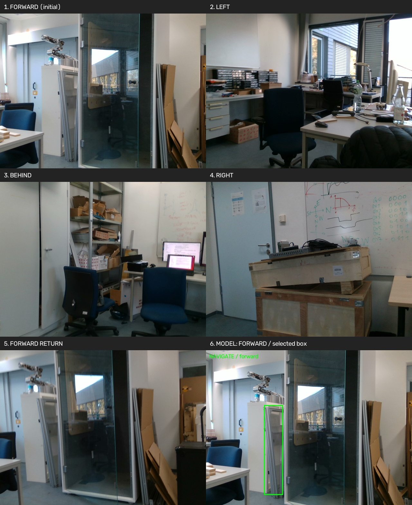
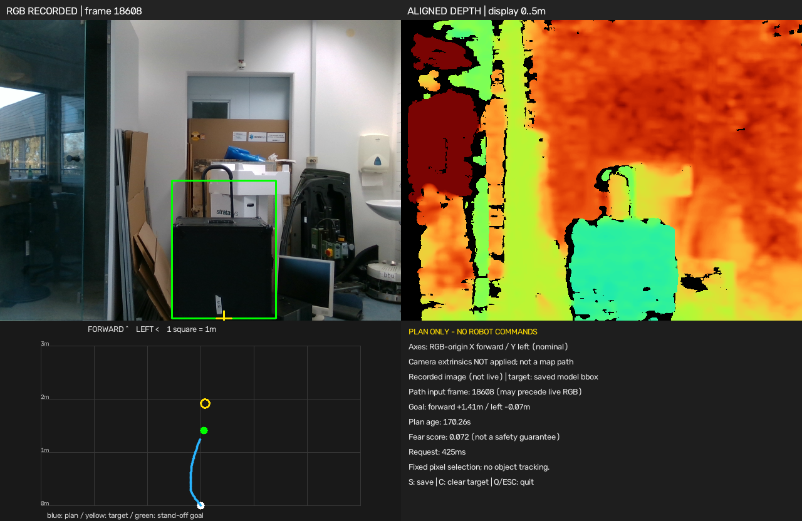
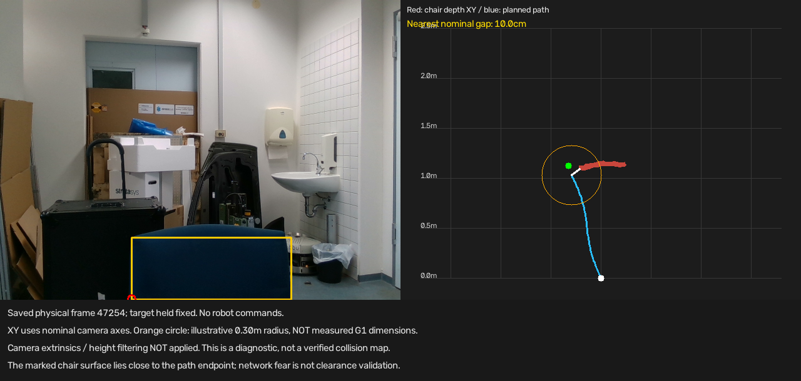

# 2026-10-15：旋转采图、模型决策和实时 iPlanner

## 已跑通的流程及范围

```text
胸前D415 → SDK/TCP → 四段真机左转、逐段停车采图
  → 前/左/后/右四张RGB请求一次G3模型 → 保存响应，结束会话

已保存模型框＋对应原始RGB-D → 本机iPlanner → 路径预览
实时RGB-D＋人工点击目标 → 持续请求iPlanner → 实时画面/深度/路径窗口
```

旋转＋模型入口没有调用iPlanner；iPlanner观察入口没有发送机器人命令。
模型返回的动作没有执行，完整导航任务没有完成。本次没有修改仿真控制流程、官方SDK、固件或GPU驱动。

## 旋转与一次模型请求

使用已测试的每段 `wz=0.8 rad/s`，IMU相对转角达到75°提前请求停车，再等待0.5秒、检查SLAM转角并采图。
75°不是SDK角度命令，也不保证每段恰好90°。
保存初始前方、左、后、右和回正五组RGB-D；模型只接收初始四方向RGB。

| 运行目录后缀 | SLAM四段合计 | 模型结果 | 判断边界 |
|---|---:|---|---|
| `155020_5347141f` | 358.194° | NAVIGATE / forward / 黑色行李箱 | 框在门左侧板/框架上，模型标记最终目标不可见 |
| `160933_f63564c8` | 349.534° | NAVIGATE / forward / 黑色行李箱 | 框包含前方行李箱；阶段进度 `parse_success=false` |

第二轮阶段解析错误为 `current_stage must be COMPLETED after the final stage`。
两轮 `flow_report.status=PASS` 表示采图与一次请求完成，不表示语义任务成功或完整G3阶段状态通过。
第二轮也说明四段约90°可能累计偏离一整圈约10.47°。

原始结果摘要：[第一轮流程](rotation_model_first_flow.json)、[第一轮响应](rotation_model_first_response.json)、
[第二轮流程](rotation_model_second_flow.json)、[第二轮响应](rotation_model_second_response.json)。



启动步骤见[旋转采图README](../../../scripts/isaacsim_lavira_g3_interface_g1/README_ROTATION_CAPTURE.md)。
新入口先检查G3健康协议，采图未完整PASS时不上传，即使旧旋转探针Ctrl+C时退出码为0。
会话最终以CANCELLED结束，表示没有执行模型动作，不应伪造导航成功或执行上报。

## USB断线排查

早先一次运行完成三段旋转（SLAM约267.2°），取右方图时出现 `Robot camera stream disconnected`。
系统日志同一时间记录USB掉线，并短暂重新枚举为USB2。第四段未执行，模型没有请求。
下一次启动也在取图预检失败；掉线前旧取图进程仍在，但无法提供图像。

结束卡住的旧服务并重启后，用SDK重新识别D415，确认USB3，并用四次、间隔5秒的请求检查恢复。
软件重启不能证明线缆/接口/供电问题根因已消除。后续旋转时仍需给USB线留足余量。
端口处于监听状态不代表相机能出新帧。

## iPlanner实测与实时窗口

本机已有 `isaacsim` Python环境运行CUDA服务；客户端仍使用 `unitree_g1` venv，没有启动Isaac仿真。
服务接受实际K，但当前网络不使用K做显式视场校正；网络输入为深度和局部目标，RGB虽传输却未参与网络推理。

第二轮模型框 `[274,256,440,476]` 的底边中心为 `[357,476]`，周围有效深度第30百分位约1.907m。
名义相机前/左目标 `[1.907,-0.0906]`m；沿射线提前0.5m后的规划目标约 `[1.4076,-0.0669]`m。
实际返回51个路径点，末端约 `[1.2429,0.0088]`m，fear约0.0724，请求约425ms。
末端尚未到规划目标，不代表到达测试通过。



[原始规划结果](iplanner_recorded_plan.json)。图中RECORDED表示保存帧，不是实时画面。

实时窗口左上RGB、右上对齐深度、左下名义局部路径、右下状态。人工点击目标后每0.5秒提交最新规划任务；
相机和规划线程分离，标注路径输入帧号、结果年龄。`C`清除目标、`S`保存、`Q`/Esc退出。
像素位置固定，不做行李箱跟踪；没有把旧模型框贴到当前画面冒充新检测。
机器人可关闭，只有笔记本USB相机和本机iPlanner需要运行。

完整启动/重放命令见[规划窗口README](../../../scripts/isaacsim_lavira_g3_interface_g1/README_IPLANNER_VIEWER.md)。
实时模式保存的是本轮latest文件，后续规划会覆盖；要比较实验条件，应另行归档每种状态。

## 椅子避障：没有通过

固定归档帧47254。椅背所选区域有25197个近处有效样本，中位深度约1.123m。
按当前名义相机前/左坐标计算：

| 指标 | 结果 |
|---|---:|
| 路径折线到椅背表面最近距离 | 10.04cm |
| 规划目标到该表面最近距离 | 10.28cm |
| 该帧网络fear | 0.01266 |

此前8.47cm使用图像下部更广范围的近处点，不是这次仅椅背ROI的口径。
上述距离未应用已验证外参、地面高度或实测机器人轮廓，不是最终物理净空。
即使中心线不穿过深度点，机器人身体也未必能通过；绿色目标本身也没有做自由空间检查。



橙色圆为0.30m示例半径，不是实测G1尺寸。

固定RGB与目标的敏感性试验：

| 输入 | fear | 相对真实输入的路径点最大XY变化 |
|---|---:|---:|
| 真实保存深度，重复两次相同结果 | 0.01266 | 0 |
| **合成**：椅子ROI设为4m | 0.00428 | 11.36cm |
| **合成**：椅子ROI设为0.6m | 0.00009365 | 5.85cm |
| **合成**：整幅深度设为4m | 0.000397 | 19.48cm |

这些不是实物移走椅子的前后观测。结果说明网络响应深度，但不能把fear当作经过校验的碰撞概率。
深度通过现有PNG协议回环最大差约4.77e-7m，该帧没有超过5m的深度；未发现千倍尺度错误。
完整结果：[obstacle_analysis.json](obstacle_analysis.json)。

目前服务输出5个关键点，再用Hermite插值成路径，没有基于当前深度、地面高度及机器人宽度的几何碰撞拒绝。
观察窗口的PASS只代表路径格式和数值有效。椅子已被相机看到，尚不能归因于“障碍物太矮”。
官方[预训练说明](https://github.com/leggedrobotics/iPlanner/blob/master/README.md)提示公开权重未适配真实数据；
[上游ROS节点](https://github.com/leggedrobotics/iPlanner/blob/master/src/iplanner_node.py)另有基于fear的路径抑制。
当前HTTP实现没有这层逻辑，本帧低分也意味着照搬0.5阈值不能解决本例。

## TF、关节与指尖偏移分析

已SSH登录PC2检查，不限于笔记本 `tf2_echo`：当前ROS2域发现115话题，无TF发布者；ROS1 master未运行，
PC2本机ROS2查询遇到运行环境问题，因此不能断言所有域/服务都不存在参考。
没有取得可信的原装D435i RGB光学坐标到torso变换。SDK传感器间外参不等于相机安装到机器人的外参。

实时 `rt/lowstate` 加匹配URDF的正运动学可算torso相对于pelvis、手腕相对于torso。
[一次实时读取与FK记录](torso_live_fk.json)保存了来源；它不是收到的TF，也没有独立验证相机安装。

固定手指只保证同一接触位置的腕系偏移d固定，不能忽略它。已讨论联合求相机R/t与d共9个自由度：

```text
每次触碰：R_wrist_i * d + t_wrist_i = R_camera * c_i + t_camera
```

当前标定代码仍使用给定偏移，未知offset联合求解**尚未实现/验证**，不要把理论讨论记成完成。
细节见[手触碰README](../../../scripts/camera_extrinsics/README.md#未知指尖偏移方案仅讨论尚未实现)。

## 下一步

1. 确定可信的相机、torso/机器人基座、SLAM坐标关系。
2. 同帧显示障碍表面与实测机器人所需宽度，同时检查目标与整条路径是否可通过。
3. 固定目标，归档无障碍/加入障碍/移走障碍的真实对照；不以合成输入代替实物验证。
4. 排查G3阶段解析，再处理实际速度跟踪及iPlanner轨迹执行。当前保持只规划，不记为导航完成。
